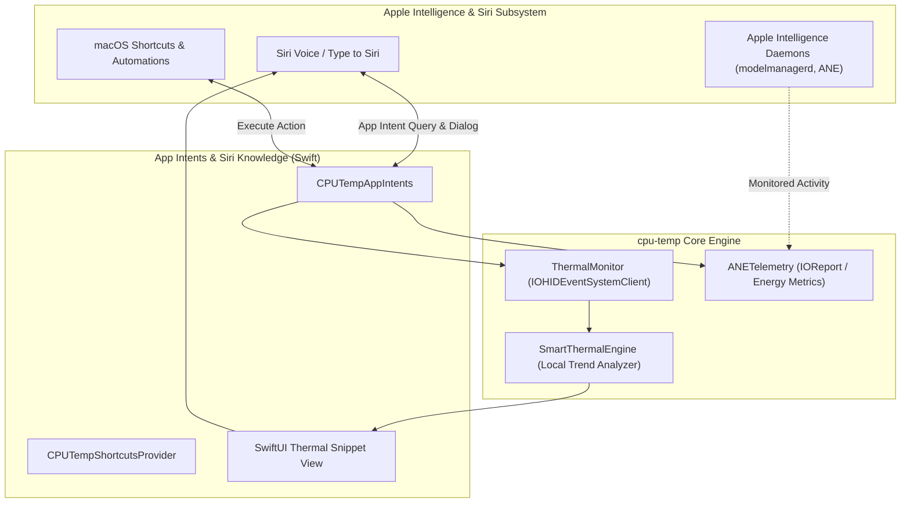

# Apple Intelligence Integration Plan for `cpu-temp`

## 1. Executive Summary

As macOS embraces Apple Intelligence, hardware utilities must evolve beyond passive numbers into conversational, context-aware assistants. For a fanless laptop like the MacBook Air, understanding thermal state, on-device AI workload impact, and battery-friendly thermal dynamics is vital.

This plan details how **`cpu-temp`** can integrate with Apple Intelligence across three core dimensions:
1. **Siri & App Intents**: Enabling Siri and Apple Intelligence to answer natural language queries (*"Hey Siri, is my Mac overheating?"*, *"What's my CPU temperature?"*).
2. **Apple Neural Engine (ANE) & AI Workload Telemetry**: Monitoring the thermal and power footprint of Apple Intelligence itself (Writing Tools, local LLM generation, Diffusion models).
3. **Smart On-Device Thermal Insights**: Delivering intelligent, natural-language health summaries rather than noisy raw-temperature alerts.

---

## 2. Technical Architecture



---

## 3. Core Feature Pillars

### Pillar 1: Siri & Semantic Queries via App Intents

By implementing the **App Intents** framework (supported in macOS 13+ and enhanced in macOS 15+ / Apple Intelligence), `cpu-temp` registers semantic actions directly with Siri.

#### Key Intents
- **`GetCPUTemperatureIntent`**:
  - *Query*: "What is my CPU temperature?" / "Check CPU temperature"
  - *Response*: Dialog stating: *"Your CPU temperature is 42°C, which is normal for your MacBook Air."*
  - *UI Snippet*: Returns an inline SwiftUI view rendered directly within Siri's interface showing current max temperature, core distribution, and a compact thermometer graph.
- **`CheckThermalHealthIntent`**:
  - *Query*: "Is my Mac overheating?" / "Why is my Mac getting warm?"
  - *Response*: Contextual diagnosis: *"Your Mac is currently at 78°C under moderate load. No thermal throttling is active."*
- **`SetTemperatureUnitIntent`**:
  - *Query*: "Switch CPU temperature to Fahrenheit" / "Change cpu-temp to Celsius"

#### Sample App Intent Implementation
```swift
import AppIntents
import SwiftUI

struct GetCPUTemperatureIntent: AppIntent {
    static var title: LocalizedStringResource = "Get CPU Temperature"
    static var description = IntentDescription("Returns the current CPU and SoC temperature of your Mac.")
    
    // Allows Siri to suggest this intent automatically
    static var openAppWhenRun: Bool = false

    @MainActor
    func perform() async throws -> some ProvidesDialog & ShowsSnippetView {
        let snapshot = ThermalMonitor.shared.currentSnapshot()
        let temp = snapshot.maxCPUTemp
        let status = temp > 80.0 ? "high" : (temp > 65.0 ? "elevated" : "normal")
        
        let dialog = IntentDialog("Your CPU is currently at \(Int(temp))°C, which is \(status).")
        let snippet = ThermalSiriSnippet(snapshot: snapshot)
        
        return .result(dialog: dialog, view: snippet)
    }
}
```

#### App Shortcuts Registration
```swift
struct CPUTempShortcutsProvider: AppShortcutsProvider {
    static var appShortcuts: [AppShortcut] {
        AppShortcut(
            intent: GetCPUTemperatureIntent(),
            phrases: [
                "What's my \(.applicationName) temperature?",
                "Check \(.applicationName)",
                "Is my Mac overheating with \(.applicationName)?"
            ],
            shortTitle: "Check CPU Temperature",
            systemImageName: "thermometer.medium"
        )
    }
}
```

---

### Pillar 2: Apple Neural Engine (ANE) & AI Workload Tracking

On Apple Silicon, Apple Intelligence features (e.g. system writing tools, image generation, semantic search) execute directly on the **Apple Neural Engine (ANE)** and the unified GPU.

#### Why This Matters for MacBook Air
The MacBook Air is fanless. Continuous on-device model execution can warm the chassis quickly:
- **`IOReport` & Channel Sampling**: Track energy channels (`ANE Power`, `GPU Power`, `CPU Energy`).
- **AI Indicator in Dropdown**:
  - In the `cpu-temp` status menu, surface an **"Apple Intelligence / ANE"** row showing active ANE thermal status and estimated wattage.
  - Detect when on-device LLMs or diffusion models are driving thermal spikes versus conventional CPU compilation or video playback.

---

### Pillar 3: On-Device Intelligent Thermal Insights

Instead of simplistic hardcoded thresholds (e.g. *"Alert: 80°C"*), integrate on-device intelligence for contextual thermal awareness:

1. **Trend & Rate-of-Change Analysis**:
   - Differentiate between a transient spike (opening an app for 3 seconds) and sustained thermal load (30-minute export).
2. **Natural Language Summaries**:
   - Menu bar hover / popover summary:
     > *"Chassis warm (68°C) due to sustained Xcode build over the last 8 minutes. Rate of cooling: -1.8°C/min."*
3. **Smart Power-Saving Automations via Shortcuts**:
   - Expose an intent trigger in macOS Shortcuts: *"If Mac temperature exceeds 85°C for > 2 minutes & on battery, enable Low Power Mode."*

---

## 4. Implementation Roadmap

| Phase | Milestone | Deliverables |
| :--- | :--- | :--- |
| **Phase 1** | **App Intents Core** | • Scaffold Swift App Intents target.<br>• Implement `GetCPUTemperatureIntent` & `CheckThermalHealthIntent`.<br>• Register `AppShortcutsProvider` so Siri recognizes voice queries instantly. |
| **Phase 2** | **Siri UI Snippets** | • Build rich SwiftUI Siri snippets with visual thermal gauges.<br>• Support both Light & Dark modes matching macOS system aesthetics. |
| **Phase 3** | **ANE & AI Telemetry** | • Add `IOReport` bindings for Apple Neural Engine power/thermal channels.<br>• Expose ANE status in the menu bar dropdown. |
| **Phase 4** | **Smart Insights & Focus Integration** | • Local rolling-window rate-of-change engine.<br>• Proactive thermal health recommendations via Shortcuts. |

---

## 5. Privacy, Performance & Battery Safeguards

1. **100% On-Device & Offline**:
   - All App Intents and thermal telemetry run strictly in local memory. Zero network telemetry or remote API calls.
2. **Zero Polling Overhead When Idle**:
   - App Intents only query hardware registers upon invocation. Siri queries incur **zero continuous battery cost**.
3. **Preserving Fanless Longevity**:
   - No heavy local LLM runtime bundled inside `cpu-temp`. It leverages native macOS system intelligence APIs and lightweight mathematical trend models to keep memory < 15 MB.
